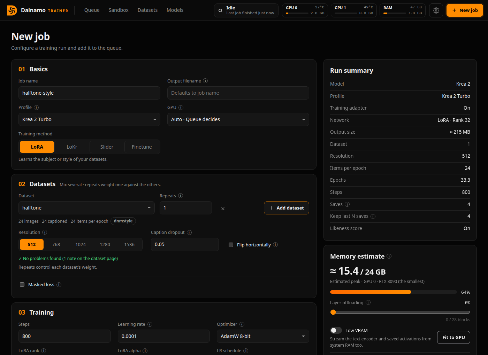
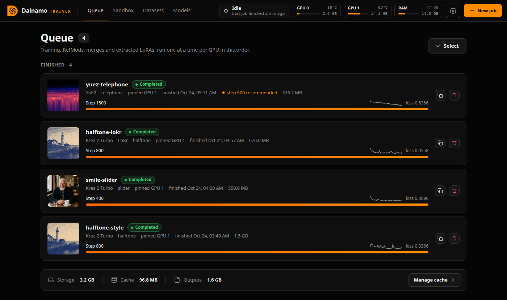
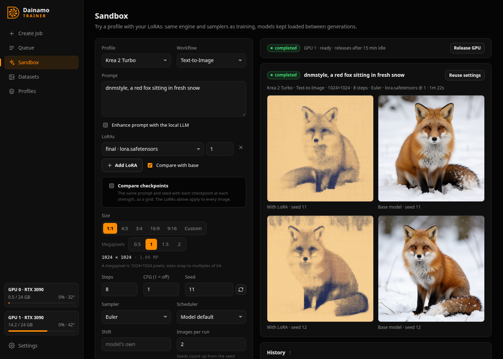
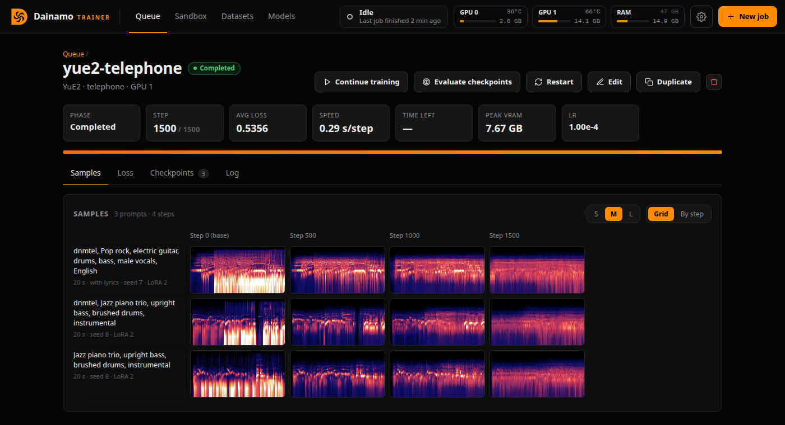

# Dainamo Trainer

A browser-based LoRA trainer for diffusion models with its own training engine.
It reads ComfyUI-format model files directly (including `fp8_scaled` weights)
and saves LoRAs that load in ComfyUI.


## Run

```bash
./launch.sh                 # Linux: first run creates .venv and builds the web UI
launch.bat                  # Windows: the same (double-click it, or run it in a terminal)
./launch.sh --port 7865 --host 0.0.0.0 --no-browser
```

Then open http://127.0.0.1:7865. The launcher installs the Python packages
again whenever `requirements.txt` changes, and rebuilds the web UI whenever its
source in `web/` changes (the build in `web/dist` isn't in git, so a `git pull`
doesn't update it). It needs Python 3.12 (or [uv](https://docs.astral.sh/uv/)),
Node.js 18+ to build the UI, and ffmpeg for video datasets and video samples.
If you start the server with `python -m dainamo` instead, rebuild the UI
yourself after pulling: `cd web && npm run build`.

Training runs in its own process. If you restart the web server, it reconnects
to running jobs instead of stopping them. A job that ended while the server was
down gets the outcome it recorded (completed, stopped or failed).

**Windows** support is new and hasn't been tested on Windows yet. The
platform-specific parts (starting, finding and stopping training processes,
file replacement while another process reads, drive letters in the file
browser) have Windows code paths, but have only been run on Linux.

### Using it from other devices

By default the server only answers on this machine. With `--host 0.0.0.0` it
can be reached from your network, and **sign-in is required**: it prints an
access key and a link (`http://<this machine>:7865/?key=…`) that signs a
browser in for 30 days, so you can open it on your phone. Scripts can send
`Authorization: Bearer <key>`.

| Option | |
| --- | --- |
| `--password PW` (or `DAINAMO_PASSWORD`) | use your own password instead of the generated key (also works on 127.0.0.1) |
| `--new-key` | replace the generated key; every device has to sign in again |
| `--no-auth` | no sign-in on the network, e.g. behind a reverse proxy that has its own. Anyone who can reach the port can then browse files and start jobs |

The key is kept in `data/auth.json`. The connection is plain HTTP, so on
networks you don't trust, put it behind HTTPS (a reverse proxy, or a tunnel such
as Tailscale).

Anyone who can use Dainamo from another device can also use
[Add from URL](#add-from-url-experimental) to make this machine download from
any web address, including addresses on your local network. The server warns
about this when it starts on the network, and the Add from URL window repeats
the warning.

## Tabs

| Create Job | Queue |
| --- | --- |
|  |  |
| **Sandbox** | **Datasets** |
|  |  |

- **Create Job**: pick a profile, the datasets, and the training settings,
  then add the job to the queue. **Datasets** are cards you add and remove,
  each with its own **repeats** (how much it counts against the others),
  **resolutions**, **caption dropout** (the chance a step uses an empty caption,
  which keeps the LoRA working without its trigger words) and **flip**
  (also train on mirror images). Each card runs the dataset's health check (see
  Datasets) for this model and its resolutions, and lists any errors and
  warnings. A video model can mix an image dataset and a clip dataset,
  for example stills at 1024 and clips at 384 and 512: images train as
  single frames and clips at the clip length. With several resolutions, each
  file is trained at each size, bucketed by aspect ratio, which helps the LoRA
  work across sizes, and the smaller steps are faster. A file too small for a
  larger size isn't upscaled or counted twice. VRAM is set by the biggest step
  (the largest size, and for clips the clip length), and the checkpoint
  picker's validation loss is measured at the largest size. The **Layer
  offloading** slider and its VRAM projection are described below, and so is
  the **Low VRAM** switch under it. Image
  models can also train a **slider** instead of a LoRA of the datasets (see
  Sliders below). **Network** under Training trains a LoRA or a LoKr (see LoKr
  below).
- **Queue**: running, queued and finished jobs, under live cards for each
  GPU (use, VRAM and temperature), the CPU (use and temperature) and system
  RAM, updated every 2 seconds. GPUs are read with `nvidia-smi` on Linux and
  Windows. Linux reports the CPU's temperature through its sensor drivers;
  Windows doesn't give programs the CPU's temperature, so it shows as "—"
  there. Each job page shows its
  samples first, as a grid with a row per sample prompt and a column per step
  (or grouped by step). Click a sample to view it full size, and use the arrow
  keys to step through training (left/right) and prompts (up/down). Below that
  are live loss, checkpoints (with download links) and a terminal with the job's
  output as it runs: a progress line per step (loss, speed, ETA), model
  loading, warnings and errors. It follows new output unless you scroll up,
  can fill the window, and the full log can be downloaded. You can stop a job
  (it saves its state), resume it, restart it from scratch, ask for samples
  or a checkpoint now, or duplicate its settings into a new job.
  **Continue training** gives a finished job more steps: it picks up from its
  last step with the same optimizer state and cached captions and images, and
  its final LoRA so far is kept as `name_002000.safetensors` (which "keep last
  N" never deletes). With a cosine or linear learning-rate schedule, the
  schedule stretches to the new length. **Open in Sandbox** on a sample (in the
  full-size view) loads its prompt, seed, size, the sampler training samples use
  (the profile's steps and CFG, Euler) and the checkpoint from that step (or the
  nearest saved one) into the Sandbox, so Generate re-creates it.
  **Disk use** shows what a job's folder holds: checkpoints, samples, cached
  captions and latents, and the training state. A finished job's cache can be
  cleared (it's made again if the job continues or is evaluated), and a
  completed job's training state deleted (it can't continue afterwards). The
  Queue page shows the total, each job's size, and clears the caches of all
  finished jobs at once.
  Sample prompts are cards: each one can set its own width, height, seed and
  LoRA strength, or leave them blank to use the Sampling defaults.
- **Sandbox**: generate with a profile and any LoRAs to test them. Pick a
  workflow (Text-to-Image, Image Edit, Text-to-Video, Image-to-Video,
  Reference-to-Video). Only the ones the profile's model supports can be
  chosen. Pick the size as a shape (1:1, 4:3, 16:9, …) and megapixels, where a
  megapixel is 1024×1024 and sizes snap to 64, so 1 MP at 9:16 is 768×1344.
  "Match input" takes the shape of the input image (edits, image-to-video), and
  "Custom" lets you type the width and height. Set the frames, steps, CFG, sampler (Euler, Heun, DPM++ 2M),
  scheduler (model default, simple, beta) and shift. **Enhance prompt** has the
  local LLM (the one used for Auto-Caption) rewrite the prompt into a detailed
  one before generating, with an instruction for the kind of workflow, and with
  the input images when the model can see. The rewrite is shown, kept with the
  run, and used again while the prompt, seed, workflow and input images stay the
  same. Changing any of them, or unchecking the box, gets a new one; with a
  random seed, each generation gets its own. Stack up to 8 LoRAs, each
  with its own strength: any job's checkpoints (the recommended one is starred)
  or any ComfyUI/PEFT or kohya-style LoRA file. "Compare with base" renders
  each seed again without the LoRAs, side by side. **Compare checkpoints**
  renders the same prompt and seed with each of a job's chosen checkpoints (up
  to 12) at each strength (up to 6), as a grid with a column per checkpoint and
  a row per strength, optionally with the base model; the LoRAs in the list
  apply to every image. While it samples, a counter shows the step, the image
  (of several), the seconds per step, and the time elapsed and estimated in
  all. The models stay loaded
  between generations, and prompt encodings are cached; the text encoder waits
  in system RAM when there's room. With two or more GPUs, the Sandbox holds the
  GPU it runs on and the training queue uses the others until you release it
  (or it has been idle for the time set in Settings). With one GPU, it runs only
  while no job is running or queued, and a job that's ready to start makes it
  unload after the current generation. It has the same layer offloading
  slider and Low VRAM switch as Create Job, with the projected VRAM of a
  generation.
- **Datasets**: link an existing folder or upload files. Captions are stored
  as a `.txt` file next to each image or video. **Auto-Caption** sends each
  file to a vision LLM (a `llama-server` or a model's own text encoder that
  Dainamo runs for you, or any OpenAI-compatible endpoint you run; see
  [Caption provider](#caption-provider)) and can
  prepend a trigger word. You choose a **caption style**
  (the prompt sent with each file): a detailed paragraph, one sentence, tags,
  a video style for clips, MOSS-Image's own style (a detailed paragraph that
  quotes visible text exactly and describes its layout, as MOSS-Image was
  trained on), or your own. Styles are edited in Settings, and
  each dataset remembers the one it was last captioned with, so datasets for
  different models can keep different styles.
  For clips, the captioner gets several frames together (6 by default), in order
  and with their times, so it can describe what happens and how the camera
  moves. By default it describes only the first 39 frames, the part a job with
  the default clip length trains on (training uses the start of each clip); set
  the frame count to your job's clip length, or describe whole clips. Models
  that take one image get a numbered contact sheet instead, which is also the
  automatic fallback when a server refuses several images. **Transcribe
  speech** runs Whisper (tiny to large-v3; large-v3-turbo is recommended) over
  the same span of each clip with sound, first, in its own process on a free
  GPU or the CPU, and what's said goes into the caption. Silence, music and
  noise are kept out of transcripts with Whisper's no-speech check. The
  captioner can't hear anything itself, and Whisper writes down speech only.
  Each dataset remembers these choices too. A reasoning model's thinking is
  left out of captions. A caption cut off at Max tokens (600 by default, in
  Settings) is asked for again with four times the room. A caption that comes
  back empty, is still cut off, or was cut short because the server's context
  filled up is never saved: the file is listed with the reason, so you can
  caption just the missing ones again (leave **Overwrite existing captions** off).
  Reference images (Qwen-Image 2.1 edit sources, MiniMax H3 ref2va references)
  go in a `_refs` folder inside the dataset, named after the image or clip they
  belong to: `_refs/photo.png`, `_refs/photo_1.png`, and so on. For an edit
  dataset, the image is the result and its caption is the instruction.
  **Split into clips** makes a copy of a dataset with its videos cut into clips
  a video model trains on whole, each video counting once per epoch (see
  [Split into clips](#split-into-clips-video-models)).
  **Add from URL** (experimental) downloads a video, or only its sound, from a
  web page into the dataset with yt-dlp (see
  [Add from URL](#add-from-url-experimental)).
  **Health check** looks for problems for a chosen model and resolution:
  - files that can't be read;
  - images and clips with fewer pixels than the resolution, which train
    smaller since files are never upscaled (flagged at each of the job's
    sizes when they'd train with under 75% of the pixels a large enough file
    of their shape gets; a training job's log counts them the same way);
  - near-duplicate images (by perceptual hash);
  - missing or empty captions;
  - captions longer than the model reads (Krea 2 and MiniMax H3 read 512
    tokens, LTX 2.5 1024);
  - two files sharing one caption (a.png and a.jpg);
  - clips shorter than the clip length;
  - notes: captions without the trigger word, caption files with no image,
    and how many videos a split dataset's clips were cut from.

  What it learns about a file is kept until the server restarts, so checking
  again is quick. **Edit captions** changes every caption at once: find and
  replace (plain or a regular expression), add words at the start or end
  (skipped where they're already there), or remove words (whole words, with
  the leftover commas tidied). It previews the changes before applying them,
  and the last edit can be undone.
- **Profiles**: a named model setup (diffusion model, text encoder, VAE and an
  optional training adapter). The form lists which models a family needs (for
  Krea 2: Krea 2 Raw or Turbo, the Qwen3-VL-4B text encoder and the Qwen-Image
  VAE), in any precision and under any file name. It checks each file's tensors
  so a wrong file is caught before training.
- **Settings**: queue mode (sequential, parallel on a single GPU, or parallel
  across GPUs), which GPUs to use, notifications, remote access (signing
  out), the caption provider (llama.cpp, a text encoder or a server you
  run), the caption styles, and the prompt enhancer's instructions.

## Caption provider

Auto-Caption and Enhance prompt use a vision LLM. In **Settings → Caption
provider**, choose who answers them:

- **llama.cpp**: Dainamo runs llama.cpp's `llama-server`. Choose the program
  (leave it blank to use the one on the PATH), a vision model (`.gguf`, e.g.
  Qwen2.5-VL or Gemma 3) and its vision projector (`mmproj-….gguf`). Dainamo
  starts it when Auto-Caption or Enhance prompt needs it; the first caption
  waits while the model loads. It stops after 10 idle minutes, or when you
  click **Stop**. It listens on 127.0.0.1 from port 8090 up, so it doesn't
  collide with a server you run on 8080.
  - **Runs on**: "A free GPU, else the CPU" takes a GPU that no training job
    or Sandbox is using (the last one first). You can also pick a GPU or the
    CPU. Training and the Sandbox come first. A job that's ready to start on
    its GPU, or a Sandbox generation there, makes it stop once the Auto-Caption
    using it is done. While they have the GPU, the next request starts it on a
    free GPU or the CPU (on the CPU when you picked that GPU).
  - Use a CUDA build of llama.cpp (the `…-bin-ubuntu-cuda-…` and
    `…-bin-win-cuda-…` downloads on its releases page). A CPU-only build, such
    as the plain `…-bin-ubuntu-x64` one, runs on the CPU whatever you choose,
    and Settings says so.
  - **Context size** 0 sizes it for the requests: 8,192 tokens for the images
    and the prompt, plus the longest reply with its retry. That's 11,264 tokens
    with the default Max tokens. llama-server caps it at the model's own
    context.
  - **Extra arguments** go to llama-server as written. For example, `-ngl 20`
    keeps part of the model in system RAM. The model, the projector, the host
    and the port are Dainamo's to set.
- **Text encoder**: no extra download. Some image models' text encoders are
  whole vision-language models, and they can write captions themselves.
  Choose the encoder's `.safetensors` file (Settings lists the ones your
  profiles use, and says which model each one is or why it can't write).
  Dainamo runs it on a GPU with its own server
  (`dainamo/engine/textgen.py`), loading the weights straight from the
  ComfyUI file with the processor and chat template from Hugging Face. It
  starts, stops and makes way for training like llama-server, but it needs a
  GPU: on the CPU, an 8B model in PyTorch would take minutes a caption.

  | Encoder file | Model | VRAM | Speed on an RTX 3090 |
  |---|---|---|---|
  | Krea 2's | Qwen3-VL-4B | 8.3 GB | ~55 tokens/s |
  | Qwen-Image 2.1's | Qwen3-VL-8B | 16.3 GB | ~37 tokens/s |
  | MOSS-Image's | Qwen3.5-9B | 17.2 GB | ~34 tokens/s |

  All three see images, and so caption images and clip frames. An int8 or fp8
  file is expanded to bf16 while the GPU keeps 4 GB free, since a quantized
  layer is expanded again for every token (about 3x slower); on a smaller GPU
  the rest stay quantized. Thinking is off. Qwen3.5 runs its linear-attention
  layers with transformers' reference code; installing `flash-linear-attention`
  makes them faster. Two encoders can't write text, and Settings says so when
  you choose them:
  - **MiniMax H3's** stops after 50 of Qwen3-VL-32B's 64 layers and has no
    final norm or output layer: it was cut down to give the diffusion model
    its features.
  - **LTX 2.5's** is Lightricks' custom Gemma 4 12B, retrained as a text
    encoder: it no longer predicts the next word (it scores about 60 nats a
    token on plain English, where a language model scores about 3). Every
    encoder is checked like this after it loads, so another retrained one is
    refused with the same explanation rather than writing nonsense.
- **Your own server**: any OpenAI-compatible endpoint (llama-server with
  `--mmproj`, Ollama, LM Studio, vLLM…), with an optional model name and API
  key. **Test connection** lists its models.

For the two that Dainamo runs, Settings shows whether it's loading or ready,
where it runs, and its log (all of it is in `data/local-llm.log`). A failed
start shows what the server reported, with a hint for the common causes: out
of memory, an unknown argument, a llama.cpp too old for the model, or the wrong
projector. If the Dainamo server is killed, the next one stops the server it
left running. Choosing another provider stops the old one's server once
nothing is using it.

The llama-server command line, the readiness check and the log hints follow
[LLMHub](https://github.com/William-Kruta/LLMHub).

## Notifications

When a job ends, the open app shows a message and marks the tab's title. It can
also show a browser notification. Browsers only allow those on
`http://127.0.0.1`/`localhost` or HTTPS, so they don't work over a plain LAN
address.

The server can also send a message to a webhook, for **ntfy** (the ntfy app on
your phone), **Discord**, **Slack**, or any URL as **JSON** (`{event, title,
message, url, job_id, status}`). You choose which endings to send: finished,
failed (or interrupted), and stopped. A message carries the step, average loss,
duration and the LoRA's file name, or the error for a failed job (for example
CUDA out of memory). If you set the app's address, it also links to the job.
"Send a test" checks the setup before a real job ends.


## Checkpoint picker and concept bleed (optional)

Both are off by default. Turn them on in section 06 of Create Job. They run
each time a checkpoint is saved, and once at step 0 as a baseline.

- **Best checkpoint picker.** Validation images are either held out of
  training (chosen reproducibly from the job seed) or taken from a separate
  dataset. Every checkpoint is scored on them with the same noise and the same
  timesteps each time. The timesteps are quantiles of the model family's own
  training distribution. Because of this the validation curve is smooth, and
  it turns upward when the LoRA starts to overfit. The checkpoint with the
  lowest validation loss is recommended, and "keep last N" never deletes it.
  Optionally, the recommended checkpoint is rendered at several LoRA strengths
  at the end.
- **Concept bleed detector.** Prompts without the trigger word are rendered
  with a fixed seed, by the base model and by each checkpoint, and compared
  using DINOv2 image features (`facebook/dinov2-small`, downloaded once). Two
  numbers are reported:
  - **Bleed:** how far those images moved toward your training images. 0%
    means they're no closer to your dataset than the base model's image; 100%
    means they're as close as your own images are. In testing, pasting a small
    copy of the subject into an image scored about 30%, and runs with no
    leakage scored 0–9%. The default recommendation limit is 25%.
  - **Drift:** how much those images changed at all, where 100% means as much
    as a new random seed would. High drift means the LoRA alters unrelated
    images even when your concept isn't leaking. DINOv2 is fairly
    colour-invariant, so a pure colour cast shows up mostly as drift.

  With both features on, the recommendation skips checkpoints above the bleed
  limit. Some bleed is expected for style LoRAs.

**After training**, **Evaluate checkpoints** on a finished job's page runs
either or both on the checkpoints it saved, whether or not they were on during
training. It goes through the queue like a job: it loads the model once, scores
the base model and then each checkpoint, and recommends one, with the strength
sweep if it's on. The job keeps its outcome, and its results from training
are kept too (the panel switches between the two). A new evaluation replaces
the previous one. Two things to know:

- The picker needs images the LoRA didn't train on. If the job held images
  out, the same ones are used again. Otherwise choose a dataset of other
  pictures of the same subject. Scored on its own training images, the last
  checkpoint would always look best.
- Only checkpoints still on disk can be scored. Set **Keep last N saves** to 0
  (keep all) on a job you might evaluate later.

## LoKr

**Network** under Training chooses what a job trains: a LoRA, or a LoKr
(LyCORIS's Kronecker-product adapter). A LoKr splits each layer's change into a
small matrix and a large one and learns their Kronecker product, so few weights
can make a full-rank change. **LoKr factor** sets the split: the lower it is,
the more weights the LoKr trains (Auto splits each layer as evenly as it can,
for the fewest). Rank and alpha don't apply to a LoKr. The summary shows the
file size to expect either way.

A LoKr is saved with LyCORIS's `lokr_w1` / `lokr_w2` keys, which ComfyUI's LoRA
loader reads: load it as you would a LoRA. Its metadata records it as a
LyCORIS LoKr (`ss_network_module`, `ss_network_args`). The Sandbox applies
LoKrs too, including ones from other trainers (low-rank and kohya-style
files; not DoRA, LoHa or LoKrs for convolutions).

Switching **Network** to LoKr doubles the learning rate (2e-4 for the usual
1e-4) and switching back halves it, unless you've changed it: a LoKr learns
more slowly than a LoRA at the same rate.

In testing, a halftone duotone style (24 images with a trigger word, Krea 2
Turbo, 512 px, AdamW 8-bit, 800 steps, the same seed) was trained as a rank-32
LoRA and as a factor-16 LoKr. Both took the same time per step (2.58 and 2.57
s/step) and about the same memory (14.7 and 14.3 GB peak). The LoKr trained
47.5M weights to the LoRA's 107.3M, and its file was 95 MB to 215 MB. Each run
sampled a lighthouse and a portrait with the trigger, and the lighthouse
without it:

| Network | Learning rate | Full style by | Portrait at step 800 |
| --- | --- | --- | --- |
| LoRA | 1e-4 | step 400 | face washed out |
| LoKr | 1e-4 | step 600 (halftone at 400, in the base colors) | face kept |
| LoKr | 2e-4 | step 600 | face kept |
| LoKr | 4e-4 | step 400 | face washed out, like the LoRA |

At 4e-4 the LoKr behaved much like the LoRA. At 2e-4 it took about 200 steps
longer to learn the style, and the portrait kept its face to the end. All four
carried the style into the prompt without the trigger about equally.

ComfyUI's LoRA loader read the LoKr as LoKr patches on all 224 layers, with no
keys left over, and its weight changes were exactly the Kronecker products.
Sandbox renders differ a little more from the training samples for a LoKr than
for a LoRA, because of rounding: the file is bf16, and each of a LoKr's weight
changes is a single product, so its rounding doesn't average out as a LoRA's
sum over its rank does. With fp32 weights they match exactly.

## Sliders

A slider is a LoRA whose strength moves one attribute of a subject, either
way: a smile slider at +1 makes people smile, at -1 frown, and at 0.5 smile a
little. Choose **Slider** under Train in Create Job (Krea 2, MOSS-Image and
Qwen-Image 2.1; not the video models yet) and give it three prompts:

- **Target:** what the slider changes, e.g. "a photo of a person". The LoRA
  trains on this prompt, so it works best on prompts like it.
- **Positive** and **negative:** the target at either end, e.g. "a photo of a
  person, smiling broadly" and "a photo of a person, frowning".

Each step noises a training image, and the base model (the LoRA off) predicts
it under all three prompts. The LoRA, at +1 or -1 (one of the two at random),
learns to turn the target prompt's prediction into the target's plus or minus
**guidance strength** times the difference between the positive and negative
ones. This is the Concept Sliders objective (Gandikota et al., 2023), on
flow-matching velocities. A step costs about twice a normal one: three extra
forward passes without gradients.

Captions aren't used. A dataset is optional: its images only need to show the
target. Without one, the base model first renders **images to render** (16 by
default) of the target prompt with the profile's sampler, square at the
largest resolution, and trains on those. They're kept in the job folder's
`slider_images/`, so a resumed job doesn't render them again. Each sample
prompt renders at every **sample strength** (-1 and 1 by default) with the same
seed, and step 0 shows the base model. Switching to Slider sets 500 steps and
rank 16, since a slider learns one direction. The checkpoint picker is off for
sliders: a slider isn't trained to reproduce its images, so their validation
loss says nothing about it. Concept bleed works as for a LoRA. The LoRA file
records the three prompts, the strength and the two settings below in its
metadata (`dainamo.slider.*`).

**Preservation** chooses how the slider keeps the rest of the image as it is,
by the kind of slider:

- **Keep the layout** (the default; for sliders that change a detail, such as
  expression, lighting or style): the noisiest steps decide the layout,
  clothes and background. Above the chosen noise level (0.9 by default; 1 is
  pure noise) the slider is trained to change nothing, and those steps skip
  the positive and negative predictions, so they're faster.
- **Keep listed attributes** (for sliders that change shape, such as age or
  weight, which the noisiest steps decide): attributes the slider shouldn't
  change, such as "outdoors", "wearing a dark jacket" or "an old man". Each
  step adds one of them, or none, to all three prompts. With the setting or
  the clothes named on both sides, the difference between the positive and
  negative prompts no longer carries what tends to come with the attribute
  (smiling photos tend to be brighter and more posed, for example). This is
  how the paper preserves attributes. Each attribute adds three captions to
  encode once; the steps cost about the same. The list is optional.

A slider also changes things other than its attribute, more so the longer it
trains. In testing, a smile slider on Krea 2 Turbo (512 px, learning rate
2e-4, guidance 3, 400 steps, 12 rendered images) was trained four ways with
the same seed. Each one sampled three prompts (a woman in a park, an old man
at a cafe, a firefighter by a fire truck) at -1, 0 and 1. All four smiled and
frowned. The table gives how much the -1 and 1 samples changed from the
sample at 0, averaged over every pixel (0-255; the expression's own change is
part of it):

| Preservation | Step 200 | Step 400 | s/step |
| --- | --- | --- | --- |
| None | 38 | 41 | 4.57 |
| Keep listed attributes (8) | 44 | 40 | 4.85 |
| Keep the layout (0.9) | 17 | 18 | 4.24 |
| Both | 21 | 27 | 4.25 |

Without keeping the layout, both directions changed clothes, framing, props
and backgrounds by step 200: a blazer on the woman, a cap on the man, another
coat and helmet on the firefighter. That happened even with "wearing a dark
jacket" and "wearing a white shirt" among the listed attributes. Keeping the
layout held the scene at both steps; by step 400 only small things moved, such
as hair and a helmet's color. Adding the attributes to it made it slightly
worse, so Create Job offers one or the other. A normal LoRA at the same
settings takes 2.42 s/step. If a slider changes too much, use an earlier
checkpoint, a lower strength or a lower guidance strength.


The samples above are from an earlier smile slider at the same settings,
trained without preservation. By step 400 the +1 samples change the clothes
as well as the expression.

## Music (YuE2)

YuE2-3B (M-A-P) writes whole songs, vocals included, from style tags and
lyrics. Its checkpoint holds two transformers that share attention. The
**composer** writes an optional score (ABC notation) and then semantic tokens,
25 a second. The **acoustic model** turns those into audio latents by flow
matching. The 48 kHz stereo VAE and the tokenizer are in the same file, so a
profile needs just that one file. Dainamo trains a LoRA on the acoustic model
only. The composer can't learn from recordings, because the tokenizer that
turns audio into its semantic tokens hasn't been released. So a YuE2 LoRA
learns how songs sound: the style, instruments, timbre, production and mix.
The melody, the song's form and where the words fall still come from the
frozen composer.

**Datasets.** Use songs in WAV, FLAC, MP3, OGG, M4A, Opus or AAC, each with a
`.txt` caption beside it that holds its style tags. Lyrics go under a
`[Lyrics]` line, marked with YuE2's section tags:

```
indie folk, female vocals, acoustic guitar, warm, intimate
[Lyrics]
[Verse]
Morning light on the kitchen floor
[Chorus]
...
```

The trigger word is added to the style tags. Auto-Caption doesn't describe
audio, so music captions are written by hand. "Swap stereo channels" is
music's version of flip. The health check for a music model flags songs
shorter than 5 s (skipped), songs longer than 6 minutes (only their first 6
minutes train), files below 44.1 kHz and mono files.

**Clip length.** Songs train as clips of the clip length (30 s by default),
spread evenly over the song so its end isn't lost: a 3-minute song gives six
clips. Clips train on the style tags alone, since there's no way to tell which
of the song's words fall in a clip. Lyrics are used only with a clip length of
0, which trains whole songs (up to 6 minutes, at about 4.7 GB of VRAM).
Training conditions on what the composer computes from the tags and lyrics
with planning off and no semantic tokens. That is the paper's "direct audio
generation" task, one of the four the model was trained on, and the regime of
Starnodes' ComfyUI-YuE2-Trainer.

**Sampling.** Samples and the Sandbox run the whole release pipeline. The
composer writes a score if the profile's **Score planning** is on (off,
melody, or full), then the semantic tokens. The acoustic model renders them
with the LoRA, using 32 midpoint steps (the release's solver, so there's no
sampler choice), and the VAE decodes the result. Planning is off by default,
since that's closest to how the LoRA trains. Sample cards and the Sandbox take
style tags, lyrics and a length (5 s to 6 minutes). Results are saved as
256 kbps MP3s with a spectrogram poster, plus the score as an `.abc` file when
Score planning is on.

**LoRA strength 2.** A YuE2 LoRA acts at about half strength in normal
generation, so samples, the Sandbox and strength sweeps default to 2, and the
saved file records it (`dainamo.recommended_strength`). The cause is that
training sees only the text, while generation also gives the acoustic model
the composer's semantic tokens, which carry much of the sound. To measure
this, 12 songs were trained with a telephone effect (a 400–3000 Hz band-pass,
which takes the share of energy below 250 Hz from 50–75% to under 1%):
1500 steps on 20 s clips. Then the same three prompts and seeds were
generated with each checkpoint. The table shows each prompt's share of energy
below 250 Hz:

| LoRA | strength 1 | strength 2 |
| --- | --- | --- |
| none (base model) | 66 / 70 / 74% | — |
| step 500 | — | 34 / 9 / 55% |
| step 1000 | — | 0.6 / 0.75 / 3.4% |
| step 1500 | 51 / 38 / 68% | 3.1 / 2.4 / 7.1% |

In the training regime (text only), step 1500 at strength 1 gives
0.06 / 0.05 / 0.09%, so the LoRA has learned the effect fully, and strength 2
brings it out in normal generation. Starnodes' trainer also recommends
weight 2. Prompts without the trigger word changed as much as prompts with it,
so loading a YuE2 LoRA turns its style on for every prompt.



**The checkpoint picker** works for music, but read its numbers with care. Its
validation loss measures how well the LoRA re-creates the held-out songs from
their tags. In the test above it rose from 1.13 (step 500) to 1.43 (step 1000)
and 1.89 (step 1500), because the LoRA was memorising its songs, while the
effect was still being learned until step 1000. Listen to the samples as well.
Concept bleed compares images, so it's off for music.

**ComfyUI.** LoRAs are saved under the checkpoint's own weight names
(`diffusion_model.model.layers.N.self_attn.qkv_proj`, `o_proj`,
`mlp.gate_up_proj`, `down_proj`, as `lora_A` / `lora_B` with `alpha`), so
ComfyUI's LoRA loader applies them to its YuE2 model. Use strength 2 there
too.

**VRAM.** Training on 30 s clips needs about 2.5 GB, and whole songs about
4.7 GB. While a sample is made, the composer (dequantized to bf16, about
4 GB), the acoustic model and the VAE are loaded together, which peaks at about
8.5 GB for a 30 s song. A training job loads the composer for each round of
samples and drops it afterwards; the Sandbox keeps it loaded between
generations.

## Split into clips (video models)

A video model trains on the start of each clip, up to the job's clip length
(39 frames, 1.6 s, by default for MiniMax H3), so most of a long video is never
used, and VRAM limits how long a clip can be. **Split into clips**, on the page
of a dataset with videos, makes a new dataset with each video cut into clips
that a job trains on whole. The original dataset is left as it is.

- **Clip length.** Pick a video model's profile, a GPU, the training
  resolution and the offload, and Low VRAM for a small card. The dialog lists each clip length the model
  takes (MiniMax H3: 17n + 5 frames; LTX 2.5: 8n + 1) with its projected VRAM
  (for batch size 1 and the model's other defaults), and picks the longest
  that leaves 0.75 GB free, as Fit to GPU does. For MiniMax H3 on a 24 GB GPU
  with the default 40% offload, that's 141 frames (5.9 s) at 384 px and
  73 frames (3 s) at 512 px; with no offload, nothing fits. In testing, a
  MiniMax H3 job at 384 px on 124-frame (5.2 s) clips peaked at 21.7 GB,
  against a projection of 22.4 GB.
- **Shots.** With **Keep each clip inside one shot** (on by default), ffmpeg's
  scene detection finds each video's cuts first (a scene score of 0.3, on a
  144 px copy of each frame), and clips stay a frame clear of each cut, since a
  clip that spans a cut teaches the model to cut. A shot with room for several
  clips gets them with equal gaps around them. A shot too short for a clip
  gives one shorter clip if it's at least 1 s long, snapped down to a length the
  model takes, unless **Keep shots shorter than a clip** is off.
- **Clips per video** (8 by default; 0 for all) caps how many a long video
  gives, picked evenly over it: full-length clips first, then the longest
  shorter ones.
- **Each video counts once.** The new dataset's `.clips.json` records the video
  each clip came from. Each epoch trains one of a video's clips, picked at
  random (at each of its resolutions, flips and repeats), so a long video
  counts no more than a short one and adds variety instead of weight. Create
  Job counts items per epoch the same way, and the checkpoint picker holds out
  a whole video and validates its first clip. A clip added to the dataset later
  counts on its own.
- **Files.** Clips are re-encoded at the model's frame rate (24 fps) with x264
  (CRF 17) and AAC sound, and scaled so their shorter side is at most 1024 px
  (or 512, 768 or 1280, or kept as it is), never up. Images and sound files are
  copied as they are, and a video's reference images in `_refs` are copied for
  each of its clips.
- **Captions.** Each clip gets its video's caption, or none, to Auto-Caption
  each clip on its own. A long video's caption often doesn't fit every part of
  it.

The split runs in the background, with its progress on the source dataset's
page. Cancelling it removes the partial copy.

## Add from URL (experimental)

**Add from URL**, on a dataset's page, downloads a video, or only its sound,
from a web page into the dataset, using [yt-dlp](https://github.com/yt-dlp/yt-dlp),
which supports YouTube and many other sites. It's a quick way to gather source
footage for a video model (then **Split into clips** and **Auto-Caption**) or
songs for YuE2.

> **Experimental.** Websites change often, and a change can break yt-dlp until
> it's updated. If downloads from a site start failing, click **Update yt-dlp**
> in the window first.
>
> **Download only what you have the right to use.** Copyright and each site's
> terms are your responsibility.

- **Video** comes as an mp4 no taller than **Largest size** (1080p by default;
  training scales every file down to its resolution anyway), as H.264 with AAC
  sound where the site offers it. **Sound only** keeps the audio as the site
  has it, often Opus or AAC.
- **From** and **To** (`1:30` or `90`) download just that part, cut where you
  asked rather than at the nearest keyframe, so a long video doesn't have to
  come down whole.
- **Playlists.** By default a link downloads one item, even a playlist's link.
  Tick **It's a playlist** to download its first N items (up to 200); an item
  that fails is listed and the others still download.
- **Files** are named after the title and the site's id, such as
  `Big Buck Bunny [aqz-KE-bpKQ].mp4`, with a number added if a file in the
  dataset already has that name (files that share a name share a caption).
  They're downloaded into `data/downloads/` first and moved in when finished,
  so the dataset never has half-downloaded files. Captions are left to you or
  Auto-Caption.
- **yt-dlp** is installed in Dainamo's environment from `requirements.txt`,
  with its recommended extras (YouTube's challenge solver among them).
  **Update yt-dlp** updates it, and only it, with uv or pip. YouTube also needs
  a JavaScript runtime: yt-dlp finds [Deno](https://deno.com) itself, and
  Dainamo also passes it Node.js or Bun when they're installed. Without one,
  some formats may be missing.

The download runs in the background, with its progress on the dataset's page.
Cancelling it keeps the files already added.

## Layer offloading and VRAM projection

The **Layer offloading** slider (0–100%) keeps that share of the diffusion
model's blocks in pinned system RAM. Each one is copied to the GPU just before
it runs, while the previous block computes. The rest of the model stays on the
GPU. The model's output is the same either way. The offloaded blocks cross
PCIe again every step (forward and, with gradient checkpointing, backward), but
the copies run alongside the computation: Krea 2 at 1024 px with 50% offloaded
trained at the same speed as without, on an RTX 3090, and peaked at 12.5 GB
instead of 17.4 GB. Steps slow down when copying a block takes longer than
computing it (small images, fast GPUs). Offloading needs gradient checkpointing
to save much in training: without it, every block's weights stay saved for the
backward pass. A full-precision (fp32 or fp16) model file is converted to bf16
as it's read, so it never needs its full size in VRAM.

Next to the slider, Dainamo projects the peak VRAM of each phase of the job
(encoding captions, encoding images, training steps, sampling, and with Low
VRAM decoding samples on their own) and compares the highest with the selected
GPU (with "Auto", the smallest GPU). **Fit to GPU** picks the lowest offload
that fits, with about 0.75 GB to spare. The projection
reads tensor sizes from the model files' headers and adds the family's measured
activation memory at the job's biggest step (each dataset's largest size, clips
at the clip length) and batch size, the LoRA and its optimizer state, and the
CUDA context. On real Krea 2 runs (training
and Sandbox, 0% and 50% offloaded) it was within 0.7 GB of nvidia-smi's peak.
Caption encoding counts vision towers that run in fp32 (Qwen-Image 2.1's and
H3's) at that size, and each text encoder's measured working memory (about
2.8 GB for LTX 2.5's, 2 GB for H3's). Against the five image and video text
encoders, whole and streamed, it came out within about 1 GB, mostly above.
It assumes captions of about 256 tokens and no other programs on the GPU.
For cards too small even fully offloaded, see Low VRAM.

## Low VRAM

With every block offloaded, the text encoder is what sets the least VRAM most
jobs need: it's loaded onto the GPU whole to encode the captions. The **Low
VRAM** switch under the offload slider (off by default) streams it the same way
as the blocks: its layers, and each large part outside them (an embedding
table, LTX 2.5's text projections), stay in pinned system RAM and come to the
GPU one at a time while a caption is encoded. Only the rest of it stays on the
GPU. The encodings are identical either way. Captions are encoded once per job
and cached, so only that step slows down. The streamed parts are freed before
the diffusion model loads.

Encoding on an RTX 3090 (peak VRAM PyTorch allocated, and the time per
caption once loaded):

| Model | Text encoder | Whole | Low VRAM |
| --- | --- | --- | --- |
| Krea 2 | Qwen3-VL-4B (fp8) | 4.2 GB, 0.05 s | 0.7 GB, 0.7 s |
| Qwen-Image 2.1 | Qwen3-VL-8B (int8), with an edit reference | 11.4 GB, 0.07 s | 1.8 GB, 1.4 s |
| MOSS-Image | Qwen3.5-9B (int8) | 9.6 GB, 0.05 s | 1.9 GB, 1.4 s |
| LTX 2.5 | Gemma 4 12B (int8) | 19.0 GB, 0.3 s | 6.2 GB, 2.6 s |
| MiniMax H3 | Qwen3-VL-32B (NVFP4) | 18.3 GB, 1.5 s | 2.7 GB, 2.5 s |

Sampling comes next, so the switch also samples in two steps. While a sample
denoises, the VAE isn't loaded (unless a sample card has images for it to
encode) and the optimizer state waits in system RAM. While it decodes, the
diffusion model and the LoRA wait in system RAM too, if the GPU hasn't room for
the VAE beside them. Each round of samples moves a few GB between the GPU and
system RAM, which takes seconds. The Sandbox does the same for each render, and
keeps the VAE in system RAM between renders.

Training steps keep their saved activations in system RAM too. With gradient
checkpointing, autograd keeps each block's input until the backward pass reruns
the block, so a step holds one per block: 1.2 GB for MiniMax H3 on 39-frame
clips at 384 px, 2.1 GB on 73-frame clips. With Low VRAM, each is copied to
pinned RAM on a side stream as it's made, and back just before the backward
pass needs it, the one before it fetched while a block's backward runs, so only
about three are on the GPU at once. The loss and gradients are exactly the same.
Inputs every block shares (timestep embeddings, rotary tables, masks) stay on
the GPU, and the pinned RAM is reused each step.

The least a job needs then comes from the part of the text encoder that isn't
streamed, training, or encoding the clips. Projected with every block
offloaded, at 512 px for images and 384 px, 39-frame clips for video:

| Model | Low VRAM off | Low VRAM on | Set by | System RAM |
| --- | --- | --- | --- | --- |
| Krea 2 | 5.6 GB | 4.6 GB | training steps | 17 GB |
| Qwen-Image 2.1 | 11.4 GB | 3.2 GB | encoding captions | 14 GB |
| MOSS-Image | 10.7 GB | 3.4 GB | encoding captions | 13 GB |
| LTX 2.5 | 19.9 GB | 7.3 GB | encoding captions | 24 GB |
| MiniMax H3 | 19.5 GB | 7.1 GB | encoding clips | 24 GB |

On most cards, the saved activations were what limited how long a training
clip can be. The longest clip a job fits by the projection, with every block
offloaded and Low VRAM on, leaving the 0.75 GB that Fit to GPU leaves, without
and with them in system RAM:

| GPU | MiniMax H3, 384 px | MiniMax H3, 512 px | LTX 2.5, 384 px | LTX 2.5, 512 px |
| --- | --- | --- | --- | --- |
| 8 GB | 1.6 s → 2.3 s | 0.9 s → 1.6 s | — | — |
| 10 GB | 3.0 s → 6.6 s | 1.6 s → 3.8 s | 6.0 s → 10 s | 3.4 s → 6.4 s |
| 12 GB | 5.2 s → 9.4 s | 2.3 s → 5.2 s | 9.4 s → 10 s | 5.0 s → 10 s |
| 16 GB | 8.0 s → 9.4 s | 4.5 s → 8.7 s | 10 s | 9.0 s → 10 s |

A job takes clips of up to 10 s (9.4 s is H3's longest under that). On 8 GB,
encoding the clips is what holds H3 back, and LTX 2.5's caption encoding is
projected at 7.3 GB (it measured 6.6 GB, below).

Real runs with PyTorch limited to 7.2 GB, standing in for an 8 GB card: every
block offloaded, Low VRAM on, 6 steps on 384 px clips, then a 640x384 sample
clip with sound. Peak VRAM is nvidia-smi's. System RAM is pinned plus
anonymous memory, leaving out mapped model files, which the kernel can drop.

| Model | Clips | Peak VRAM | Projected | Per step | System RAM | Projected |
| --- | --- | --- | --- | --- | --- | --- |
| LTX 2.5 | 49 frames | 6.6 GB (encoding captions) | 7.3 GB | 6.6 s | 22.6 GB | 23.9 GB |
| MiniMax H3 | 39 frames | 7.5 GB (encoding the clips) | 7.1 GB | 7.1 s | 23.0 GB | 24.4 GB |
| MiniMax H3 | 73 frames | 7.3 GB (encoding the clips) | 7.3 GB | 11.6 s | 24.8 GB | 24.4 GB |

LTX's sample decoded with its diffusion model in system RAM; H3's had room to
decode beside it. H3's 39-frame peak was its VAE encoding the clips, 0.4 GB
over the projection but inside the limit. The first two runs were made before
training's saved activations moved to system RAM, which doesn't change those
peaks.

Keeping the saved activations in RAM is what lets the 73-frame (3 s) H3 job
fit: its training steps peaked at 6.7 GB (projected 6.8 GB), against 8.2 GB
without (projected 8.7 GB), which ran out of memory under the limit. On 39-frame
clips they went from 6.3 GB to 5.6 GB. Steps took 1% longer than without on
73-frame clips and 0.5% longer on 39-frame ones, on a PCIe x4 slot (5.9 GB/s),
since the copies run alongside the computation.

Next to the VRAM projection, Dainamo projects the system RAM the job will hold
at most, and warns when that's more than is free: offloaded blocks, a
streamed text encoder (all of it while it loads), saved activations during
training steps, and what waits in RAM while samples decode, on top of about
4 GB for the process itself. The System RAM
column of the projected table above is its highest phase. Pinned RAM is handed
out in shared slabs, since PyTorch rounds each pinned allocation up to a power
of two: pinned one tensor at a time, H3's blocks would take 1.6 times their
size. Each model's slabs are sized to waste the least (on H3's blocks, 0.9 GB
where 256 MB slabs would waste 3.1 GB).

The Sandbox has the same switch; it keeps a streamed text encoder parked in RAM
between prompts when there's room. YuE2 has no switch: its composer writes
songs a token at a time, and streaming it would copy it in for every token.

## Layout

```
dainamo/
  engine/                 training engine (runs as a subprocess per job)
    comfy_io.py           safetensors reader for ComfyUI formats (fp8_scaled, comfy_quant)
    fp8_linear.py         frozen fp8 Linear, dequantized on the fly
    offload.py            block swapping (layer offloading) from pinned slabs, streamed text encoders and saved
                          activations (Low VRAM), and parking models and optimizer state in RAM
    memory.py             VRAM and system RAM projection from file headers
    lora.py               LoRA and LoKr networks + frozen adapters, ComfyUI key formats
    dataset.py            discovery, aspect buckets, caption/trigger handling
    trainer.py            family-agnostic training loop
    slider.py             concept sliders: their settings and training step
    transcribe.py         Whisper speech-to-text for Auto-Caption (a subprocess)
    textgen.py            a text encoder that writes captions: which can, and an OpenAI-style server for it
    families/             one driver per model family
      base.py             driver interface
      krea2/              Krea 2 model + driver
      ltx2/               LTX 2.5: diffusers' LTX-2 classes loaded from ComfyUI files, and the driver
  server/
    app.py                FastAPI app: middleware, routers, the built web UI
    routes/               the API, one module per area (system, profiles, datasets, jobs, sandbox, llm)
    validation.py         job settings checks
    db.py                 SQLite store and its schema migrations
    queue.py              job queue: launches training processes onto GPUs
    procs.py              starting, finding and stopping worker processes (Linux and Windows)
    sandbox.py            the Sandbox worker process
    notify.py             webhooks when a job ends
    hardware.py           the GPUs, CPU and RAM now, for the Queue's hardware cards and the sidebar
    auth.py               sign-in for remote access
    captioner.py          the local LLM: auto-captions (images, clip frames, contact sheets) and prompt enhancement
    llama_server.py       the caption server Dainamo runs (llama-server or textgen): start, readiness, idle
                          stop, handing over its GPU
    dataset_check.py      the dataset health check
    clip_split.py         Split into clips: shot detection, clip planning and cutting, the clip-length fit
    media_download.py     Add from URL: yt-dlp downloads into a dataset, and updating yt-dlp
  webui.py                whether web/dist is up to date with its source (for the launchers)
scripts/measure_memory.py measures a family's activation memory for the projection
web/                      React + Vite UI (built into web/dist)
docs/screenshots/         the screenshots in this README
data/                     database, uploaded datasets, job outputs (data/jobs/<id>/)
```

The database schema is versioned. To change it, add a step to the end of
`MIGRATIONS` in `dainamo/server/db.py`, as SQL or a Python function, and never
edit a released step. On startup, an existing database is copied to
`data/dainamo.db.v<N>.bak` and then runs each new step once, in a transaction.

## Adding a model family

Subclass `FamilyDriver` in `dainamo/engine/families/<name>/driver.py`. A driver
declares:

- its profile fields and LoRA target layers;
- how to load the text encoder and VAE, and how to build the diffusion model
  from its tensor shapes (`build_transformer`; the shared loader reads the
  weights and handles offloading), plus the name of its block list. For Low
  VRAM, the text encoder loads to `text_encoder_device` and goes through
  `stream_text_encoder`, which streams every ModuleList named `layers` or
  `blocks` and every module of 128 MB or more outside them (drop the loaded
  state dict first, or its tensors stay in RAM beside the pinned copies);
- its `MemoryProfile`, measured with `scripts/measure_memory.py`;
- the timestep sampling;
- the forward pass;
- sampling.

Then register it in `families/__init__.py`. The queue, UI, caching, LoRA saving
and resume logic work unchanged.

## Supported weight formats

Each model file can use any of these formats; mixing formats across a
profile's files is fine.

| Format | Stored on the GPU as |
| --- | --- |
| bf16 / fp16 / fp32 | bf16 |
| ComfyUI `fp8_scaled` (per-tensor or per-row scale; current `weight_scale` and older `scale_weight` names) | fp8 |
| ComfyUI `int8_tensorwise` (per-row scale) | int8 |
| ComfyUI `int8_tensorwise` with convrot (block regular-Hadamard rotation) | int8, input rotated at runtime |
| ComfyUI `nvfp4` (E2M1 codes, swizzled E4M3 block scales, optional AWQ `pre_quant_scale`) | nvfp4, expanded per matmul |

MXFP4, GGUF and block-wise scaled fp8 are not supported yet. The profile form
flags files that use them, and loading them fails with a clear error rather
than producing wrong weights.

Weights are read straight to the GPU, so loading uses little system RAM. The
exceptions are offloaded blocks (see Layer offloading), which are read into
pinned system RAM, and with Low VRAM the text encoder, which is read into
system RAM and streamed from there.

## Tests

```bash
uv pip install --python .venv/bin/python pytest   # once
.venv/bin/python -m pytest tests -v
```

`tests/test_quant.py` builds small ComfyUI-style fp8 and int8/convrot files to
check loading, forward/backward parity, per-channel scale precision and LoRA
gradients. If both Krea 2 Turbo checkpoints are present, it also checks that
the int8_convrot weights agree with the fp8_scaled weights layer by layer.

`tests/test_moss.py` checks Dainamo's MOSS-Image DiT and sampling schedule
against OpenMOSS's own reference code, which it fetches from Hugging Face.
It also checks the training noise sampler against the technical report's
eq. (4).

`tests/test_minimax.py` checks how the MiniMax H3 driver builds packed
sequences: per-row timesteps, first-frame and reference condition rows, the
audio and no-audio cases, and that the sampler lands on the clean latent when
given the true velocity. `tests/test_offload.py` checks that block swapping
gives exactly the same outputs and LoRA gradients as a model held entirely on
the GPU, with and without gradient checkpointing, and that a streamed text
encoder (Low VRAM) gives the same outputs, keeps its layers in pinned RAM, and
parks and comes back for the Sandbox. It also checks that streamed tensors pack
into shared pinned slabs, that parking a model mid-training and its optimizer
state (while samples decode) leaves training exactly as it would have gone,
and that a model is parked to make room only when there isn't any. Training
with the saved activations in RAM (Low VRAM) gives exactly the same loss and
LoRA gradients, with blocks swapped and gradient accumulation, frees the GPU of
every saved block input except the first (and of inputs shared by every block,
which stay), and reuses the same pinned RAM each step.

`tests/test_ltx2.py` runs the LTX 2.5 driver on a tiny random DiT: the training
loss with and without audio, on images, deterministic for validation, and with
the first latent frame clean at timestep 0 for image-to-video; sampling keeps
that frame fixed, is reproducible, and runs with every sampler and schedule. It
also checks the frame and sigma schedules, the halo neighborhood attention
against diffusers' NATTEN-style mask, and the causal log-mel input. If the LTX
2.5 files are present, it checks from their headers that every tensor maps onto
diffusers' modules, and that the mel filterbank reproduces the vocoder's own.

`tests/test_qwen_image_2.py` checks the Qwen-Image 2.1 DiT against outputs of
the release's diffusers model (text-to-image, edits with one or two references,
padded batches), the sampling schedule against diffusers' scheduler, reference
sizing, and how edit and text-to-image items are batched.

`tests/test_sampling.py` checks the samplers on Gaussian data, where the
exact solution is known (Heun and DPM++ 2M converge at second order), checks
DPM++ 2M against k-diffusion's formulation, and checks the beta schedule.
`tests/test_sandbox.py` checks Sandbox requests per family and workflow, the
GPU rules shared with the training queue, the LoRA stack (strengths, stacking,
base toggle, kohya keys), parking a block-swapped model in RAM, Low VRAM's VAE
(in RAM until a render decodes, the diffusion model moving out only when there
isn't room for both), checkpoint grids (limits and labels) and the step
counter's timing.

`tests/test_memory.py` checks the shared loader with offloading (which blocks
stream, pinned in RAM, the same outputs and LoRA gradients as without), that
the projection's weight sizes match a loaded model exactly, how the projection
adds up, and that the loader and the projection round block counts the same way.
It also checks Low VRAM: the caption phase projects only the part of the text
encoder that isn't streamed plus two layers (or one large part) in flight, a
family's loader gives the same encodings with less on the GPU (less again with
the embedding table streamed), YuE2-style families that don't stream their
text encoder ignore the setting, sampling is projected in two steps (no VAE
while denoising unless a sample card has images; no diffusion model while
decoding), training steps hold three blocks' saved activations on the GPU and
all of them in system RAM (none without gradient checkpointing), and the system
RAM of each phase adds up.

`tests/test_evaluation.py` checks the hold-out split, the recommendation rules,
the deterministic validation loss and the bleed normalisation, and the items
of multi-resolution training and per-dataset settings (resolution, flip,
caption dropout) with their cache keys.

`tests/test_trainer.py` runs the trainer with a tiny stand-in model on the GPU:
a short job trains, saves and finishes, then continues to more steps (keeping
its finished LoRA, which "keep last N" spares). Evaluate checkpoints scores
every checkpoint and the base model the same way twice, leaves the job's own
results as they were, and a stopped or failed evaluation keeps what it had
scored.

`tests/test_slider.py` checks the slider step: the base model's three
predictions run with the LoRA off and without gradients, the LoRA trains at the
step's direction against the guided target, and it's still at that strength
when backward runs (checkpointed blocks run their forward again then). A tiny
slider job without a dataset renders its images, samples each prompt at each
strength, learns to move predictions toward the positive prompt at +1 and away
at -1, and keeps its rendered images when it's trained on.

`tests/test_lokr.py` checks LoKr: how layer sizes split by the factor, a LoKr
layer against the Kronecker product built in full, the saved `lokr_w1` /
`lokr_w2` keys and loading them back, the Sandbox applying LoKr files (full
matrices, a low-rank w2 with alpha, and kohya-style names) and explaining the
ones it can't (DoRA, convolution LoKrs, LoHa), and a tiny LoKr job that trains,
records LyCORIS-style metadata and continues.

`tests/test_yue2.py` checks music: lyrics split from captions, songs cut into
evenly spread clips (lyrics only with whole songs), the settings and sample
cards of music jobs, padded composer conditions matching unpadded ones on a
one-layer random acoustic model, a training step reaching the LoRA and its
ComfyUI key names, the midpoint solver, weight-norm folding, saved songs (MP3,
spectrogram, score) and the health check on audio. With the real checkpoint
it also checks the prompt format, the VRAM projection
and that the VAE keeps a chord's loudness envelope within 1.5 dB.

`tests/test_hf_assets.py` checks that Hugging Face files come from the cache
when they're there (no network), are downloaded once at the pinned commit when
they aren't (or a cached copy is missing a file), and that being offline without
them gives a clear error.

`tests/test_dataset_check.py` checks that the health check finds each kind of
problem (unreadable files, small images, near-duplicates, shared, missing,
empty and over-long captions, orphaned caption files, short clips) and reads a
file only once.

`tests/test_clip_split.py` checks Split into clips: clips planned inside
shots, a frame clear of each cut, with equal gaps and a cap spread over the
video; cut to the exact frame count at 24 fps with sound, captions and
reference images; cancelling removing the copy; each video training once per
epoch and held out whole by the checkpoint picker; and the dataset list, items
and health check counting videos.

`tests/test_captioner.py` checks how replies from the LLM are read: thinking
left out (a `<think>` block, a lone `</think>`, or a separate reasoning field), a
reply cut off at Max tokens asked for again with more room, empty and
still-cut-off replies and a full context reported as errors, the server's own
error message kept, and clips falling back to a contact sheet when frames are
refused.

`tests/test_llama_server.py` checks the caption server Dainamo runs, against a
stand-in server (`tests/fake_llama_server.py`). For llama-server, it checks the command line (a
free port from 8090, the context sized for the requests, one slot, all layers
on the chosen GPU or none on the CPU), and that requests wait while the model
loads (503) and the next request finds it running. A free GPU is taken, else
the CPU; a chosen GPU that's training is left alone; and a CPU-only build is run
on the CPU. A failed start reports
llama-server's own words with a hint (out of memory, an unknown argument, too
old for the model), and a missing program, model or projector, or extra
arguments that set the port, are named. New settings restart it only when
nothing is using it. It isn't stopped for being idle while in use, and training
or the Sandbox takes its GPU once captioning is done. One left by a crashed
server is stopped. For a text encoder, it checks that it runs on a free GPU and
never the CPU (saying why when no GPU is free), that an encoder that can't
write isn't started, that running out of memory while loading is explained,
that switching provider restarts it only when nothing is using it, and that
its idle time comes from its own settings. `tests/test_server.py` runs
Auto-Caption and Enhance prompt through it, with failed starts reported in
both, checks the caption provider settings (each provider needs its file, and
a bad section saves nothing), lists the encoders the profiles use, and checks
that a queued job waits for it to stop before starting on its GPU.

`tests/test_textgen.py` checks the text encoder server
(`dainamo/engine/textgen.py`). Header-only copies of each family's encoder
(`tests/conftest.py`, sparse files of a few kilobytes) check which can write:
Krea 2's, Qwen-Image 2.1's and MOSS-Image's can; MiniMax H3's, LTX 2.5's, an
encoder without its output layer, CLIP and T5 are refused with the reason. It
also checks OpenAI messages becoming chat-template ones (images as data: URLs
only), the server's answers (503 while loading, errors as 400s, no streaming)
as Auto-Caption reads them, and quantized layers expanded to bf16 only while
the GPU has room, with the same outputs. With a GPU, a tiny random Qwen3-VL
saved in ComfyUI's layout is loaded with the real processor: the check after
loading refuses it (random weights don't predict text), and with the check off
it answers a request with an image, the same way twice with a seed.

`tests/test_server.py` checks the API: settings merging and validation, job
validation (including several resolutions and sliders), dataset path sandboxing, the host
check, sign-in (cookie, bearer key, `?key=` links, password changes), the
notification messages for each service against a local webhook, the outcome
of jobs that ended while the server was down, queueing a checkpoint evaluation
and putting the job back afterwards (finished, cancelled or killed), giving a
finished job more steps, disk use and clearing caches and training state,
bulk caption edits (preview, whole words, regular expressions, undo), turning
a training sample into Sandbox settings, and finding and killing worker
processes with their children.

`tests/test_hardware.py` checks the hardware cards' readings: GPUs parsed
from `nvidia-smi` and read once a second however many pages ask, none without
it, CPU names without trademarks or speeds, the CPU package's temperature from
Intel's and AMD's Linux sensor drivers (not the motherboard's), and Windows,
where the CPU is named from the registry and has no temperature.

`tests/test_media_download.py` checks Add from URL with a stand-in yt-dlp, so
nothing goes to the network: the command for each choice (size, H.264, a
part cut exactly, sound only, playlists, a URL that can't be read as an
option), files moved into the dataset under names no other file has and
without half-downloaded leftovers, a playlist keeping the items that worked,
cancelling, the API's checks, updating only yt-dlp, and the warning when the
server listens on the network.

`tests/test_db.py` checks the schema migrations: a fresh database, one from
before versioning, new steps running once after a backup, a failed step
leaving nothing behind, refusing a database from a newer version, and the
caption-styles step keeping a caption prompt you had changed.

Tests use a throwaway data folder (`tests/conftest.py`), never `data/`.

## Model families

| Family | Files a profile needs | Notes |
| --- | --- | --- |
| Krea 2 | Krea 2 Raw or Turbo, Qwen3-VL-4B, Qwen-Image VAE | Turbo profiles use Ostris's training adapter. |
| MOSS-Image | MOSS-Image Base or SFT, Qwen3.5-9B, FLUX.2 VAE | Uses the ComfyUI single file with fused `proj.qkv`. Training noise follows the report's final pretraining stage. Sampling follows the reference pipeline: shift 5, Euler, CFG 3, with block 22 skipped in the negative branch. |
| Qwen-Image 2.1 | the Qwen-Image 2.1 DiT (base or Turbo), Qwen3-VL-8B, Qwen-Image 2.1 VAE (RGBA) | One checkpoint, two kinds of LoRA. Images with reference images in `_refs` train as edits: the caption is the instruction, and the references go into both the Qwen3-VL prompt and the DiT sequence. Images without references train text-to-image. Transparent PNGs train as RGBA. Sampling uses the release's 40-step schedule without CFG (Turbo: its fixed 8 steps), and sample cards can add reference images to render an edit. |
| LTX 2.5 (video + audio) | the 22B DiT (dev or distilled), Gemma 4 12B with LTX's projection, video VAE (diffusion decoder or conv), audio VAE | Trains video clips and images; clips with sound train audio jointly, and a share of clip steps train first-frame-to-video. The text connectors in the DiT file run with the text encoder, so captions are cached as the DiT's final text conditions. Distilled profiles sample with its own 8-step schedule and no CFG; dev profiles take about 30 steps at CFG 4. Sample cards can set a frame count and a first frame. Samples are saved as MP4 with 48 kHz audio. |
| YuE2 (music) | the YuE2-3B single file (int8_convrot), which holds the composer, VAE and tokenizer | Trains a LoRA on the acoustic model from songs, with style tags and optional lyrics as captions. Samples are written by the frozen composer and rendered with the LoRA, defaulting to LoRA strength 2, and are saved as MP3s. See Music (YuE2). |
| MiniMax H3 (video + audio) | the fl2va or ref2va DiT, Qwen3-VL-32B (NVFP4), video VAE, audio VAE | Trains video clips and images; clips with sound train audio jointly. fl2va also trains first-frame-to-video on a share of steps. ref2va trains with reference images from `_refs`. Sampling uses the released Euler sampler with no CFG (the model is guidance-distilled), and sample cards can set a frame count plus a first frame or reference images. Samples are saved as MP4 with AAC audio. |

The model files carry only weights, so each family also needs a few small files
from its official Hugging Face repo: the tokenizer, chat template and configs.
They're downloaded the first time a job or the Sandbox uses that family, and
after that they're read from the local Hugging Face cache, so jobs run without a
network. The same goes for a training adapter given as `owner/repo/file`,
DINOv2 (concept bleed) and Whisper. LTX 2.5 and YuE2 need none: their tokenizers are
inside their model files. Each family's repo is pinned to a commit
(`REVISIONS` in `dainamo/engine/hf_assets.py`), so an update to the repo can't
change how captions are read partway through a project. A machine whose cache
has an older commit of a repo downloads the pinned one once.

## Notes

- **Krea 2 Turbo** is distilled. Profiles for it use Ostris's turbo training
  adapter, which is applied only during training and switched off for
  sampling and saved LoRAs.
- **Performance on an RTX 3090** (LoRA rank 32, gradient checkpointing, 1024 px):
  - Krea 2: about 8–9 s/step, peaking at about 18 GB.
  - MOSS-Image: about 4 s/step, peaking at about 10 GB (the peak comes from the
    text encoder stage). A CFG sample at 1024 px takes about 2.2 s a step: about
    65 s at 30 steps, and about 110 s at the profile's default of 50, which
    MOSS-Image's user guide recommends.
  - Qwen-Image 2.1 (int8_convrot): about 2 s/step on 512 px edit pairs, peaking
    at about 12 GB. Sampling: 1.35 s/step at 1024 px (40 steps, about 55 s); an
    edit at 1344x768 with a same-size reference takes 2.8 s/step.
  - MiniMax H3: about 5.4 s/step on 39-frame clips at 384 px with 20 of the 50
    blocks streamed from RAM, peaking at about 20 GB. A 39-frame 640x384 clip
    with audio samples at about 3 s/step (20 steps, about 1 minute).
  - LTX 2.5 (int8_convrot, 60% of the 48 blocks streamed): about 4.5 s/step on
    25-frame clips at 384 px (rank 16). A distilled 768x512, 49-frame clip with
    audio samples in about 21 s (2.6 s/step) and decodes in about 27 s, peaking
    at about 13 GB.
  - YuE2 (int8_convrot): about 0.21 s/step on 20 s clips (rank 32, batch 1),
    peaking at about 2.3 GB. A 1500-step job with samples every 500 steps took
    under 8 minutes. A 12 s song samples in about 13 s.
- **LTX 2.5 dev or distilled:** a LoRA can be trained on either file; the
  profile's variant only sets how samples are made (distilled: its own 8-step
  schedule without CFG; dev: about 30 steps at CFG 4). Dev
  (`ltx-2.5-22b-dev-transformer-comfy-int8-convrot.safetensors`) is the usual
  base for LTX LoRAs. The diffusion video decoder's neighborhood attention runs
  on plain PyTorch (no NATTEN needed).
- **LTX 2.5 memory:** at its default 60% offloading, 29 of the 48 blocks (about
  11 GB) sit in pinned system RAM. Encoding captions loads Gemma 4 and the text
  connectors (about 16 GB of VRAM) before the DiT, and each cached caption is
  about 12 MB (the DiT's final 1024-token text conditions).
- **MiniMax H3 memory:** the streamed blocks sit in pinned system RAM (about
  0.4 GB per block; 20 blocks is about 8 GB), and the model files total about
  40 GB. Two MiniMax jobs in parallel need twice the RAM. Its jobs default to
  40% layer offloading (20 of 50 blocks); lower it for speed if VRAM allows.
- **Licensing:** no ComfyUI code is included. See `THIRD_PARTY_NOTICES.md`.
  LTX 2.5 is under the LTX-2.x Community License: entities with $10M or more
  in annual revenue need a paid license from Lightricks for anything beyond
  non-commercial testing and research, and a shared LoRA must carry the
  agreement and its use restrictions.
  Qwen-Image 2.1's weights are under the Qwen Research License: non-commercial
  use only, and a distributed model trained with it must say "Built with Qwen".
  YuE2's weights are under CC BY-NC 4.0, plus a permission (2026-09-16)
  letting individuals, such as creators and musicians, use them free of charge
  and sell the songs they make. Companies need a commercial license from
  M-A-P. A shared LoRA likely counts as adapted weights, which CC BY-NC's
  attribution and non-commercial terms cover.
  MiniMax H3 is under the MiniMax H3 Community License (see `NOTICE`). Its
  grant excludes the EU, the UK, South Korea and the US, and it bans using
  MiniMax H3 or its outputs to improve other models. Dainamo ships no weights;
  whether you may run them is between you and that license.
