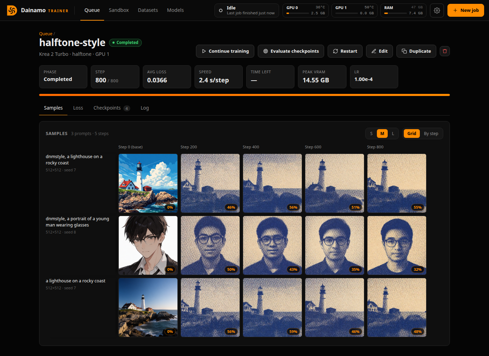

# Dainamo Trainer

[](https://github.com/DainamoLabs/dainamo-trainer/actions/workflows/ci.yml)

A LoRA trainer for diffusion models that runs in your browser, with its own
training engine. It reads ComfyUI model files directly, including `fp8_scaled`,
int8 and nvfp4 weights, and saves LoRAs that load in ComfyUI. It trains Krea 2,
MOSS-Image, Qwen-Image 2.1, LTX 2.5, MiniMax H3 and YuE2.



## Run

```bash
./launch.sh                 # Linux: first run creates .venv and builds the web UI
launch.bat                  # Windows: the same (double-click it, or run it in a terminal)
./launch.sh --port 7865 --host 0.0.0.0
```

It prints the link to open, http://127.0.0.1:7865 by default. `--browser`
opens it in your browser for you.

You need Python 3.12 (or [uv](https://docs.astral.sh/uv/)), Node.js 18+ and
ffmpeg. The launcher reinstalls packages when `requirements.txt` changes and
rebuilds the UI when `web/` changes. If you start the server with
`python -m dainamo` instead, run `cd web && npm run build` after each
`git pull`: the build in `web/dist` isn't in git.

Training runs in its own process, so restarting the server doesn't stop running
jobs. Windows has its own code paths but has only been run on Linux so far.

### Using it from other devices

With `--host 0.0.0.0` the server answers on your network and **requires
sign-in**. It prints an access key and a link (`http://<this machine>:7865/?key=…`)
that signs a browser in for 30 days. Scripts can send
`Authorization: Bearer <key>`.

| Option | |
| --- | --- |
| `--password PW` (or `DAINAMO_PASSWORD`) | use your own password instead of the generated key (also works on 127.0.0.1) |
| `--new-key` | replace the generated key; every device has to sign in again |
| `--no-auth` | no sign-in on the network, e.g. behind a reverse proxy that has its own. Anyone who can reach the port can then browse files and start jobs |

The key is kept in `data/auth.json`. The connection is plain HTTP: on networks
you don't trust, put it behind HTTPS (a reverse proxy, or a tunnel such as
Tailscale). Anyone signed in can use
[Add from URL](docs/datasets.md#add-from-url-experimental) to make this machine
download from any address, including ones on your local network.

Other websites open in your browser can't use the app on your behalf: changes
(starting jobs, writing files) are only accepted from the app's own pages, or
from scripts that call the API directly.

## First job

1. **Models → Model files**: set your ComfyUI models folder, download what's
   missing, then **Create profile**.
2. **Datasets**: link a folder or upload files. Captions are `.txt` files next
   to each file; **Auto-Caption** writes them once a caption provider is set
   up in Settings.
3. **New job**: pick the profile and datasets, set the steps and sample prompts,
   and press **Fit to GPU** if the projection says it won't fit. **Add and
   start** runs it; **Add to queue** keeps it ready until you press **Start**.
4. **Queue**: open the job for its samples, loss and log. The LoRA is saved in
   `data/jobs/<job name>_<id>/` and downloadable from the Checkpoints tab.
5. **Sandbox**: generate with the LoRA and compare it with the render without
   it.

## Documentation

- [Profiles and model files](docs/profiles-and-model-files.md)
- [Merge & extract](docs/merge-and-extract.md): LoRAs merged into one, LoRAs extracted from any finetuned model
- [Datasets](docs/datasets.md): edit datasets (sources and results), health check, caption edits, Split into clips and the clip editor, Add from URL
- [Captions](docs/captions.md): Auto-Caption and the caption provider
- [Jobs](docs/jobs.md): New job, the queue, editing and continuing jobs, the checkpoint picker, notifications
- [Sandbox](docs/sandbox.md)
- [Upscaling](docs/upscaling.md): Real-ESRGAN and SeedVR2 in the Sandbox, and a dataset's small images
- [Likeness](docs/likeness.md): how much a sample or an output looks like a dataset, and a dataset's duplicates
- [LoKr](docs/lokr.md), [Sliders](docs/sliders.md), [Full finetuning](docs/finetuning.md), [RefMods](docs/refmods.md), [Music](docs/music.md)
- [Memory](docs/memory.md): layer offloading, VRAM projection, Low VRAM
- [Model families](docs/model-families.md): what each needs, weight formats, speeds, licenses
- [Development](docs/development.md): code layout, adding a model family, tests

## License notes

No ComfyUI code is included; see `THIRD_PARTY_NOTICES.md` and `NOTICE`.
Dainamo ships no model weights. Several models have non-commercial or regional
terms: read [Licenses](docs/model-families.md#licenses) before you share a LoRA
or use one commercially.
