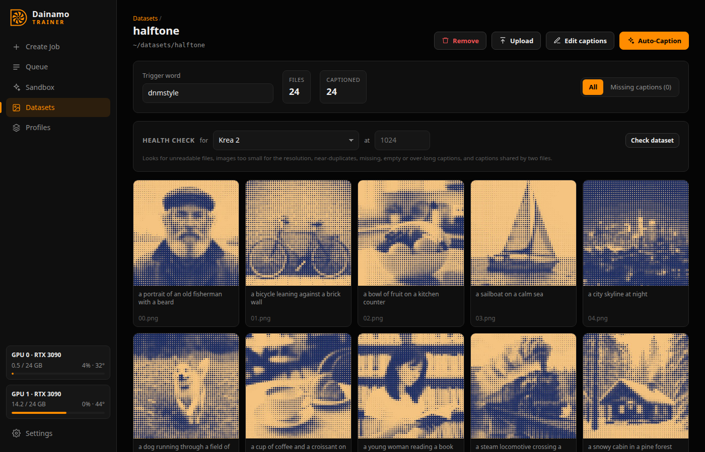

# Datasets

A dataset is a folder of images, videos or songs. Link an existing folder or
upload files. Each file's caption is a `.txt` file next to it with the same
name. To write captions with a vision LLM, see [Captions](captions.md).

Click a file to enlarge it. The **Left/Right** arrow keys, or the on-screen
buttons, move between files in the grid's order. You can edit the caption
there: **Save**, or Ctrl/Cmd+Enter. Unsaved edits are saved when you move to
another file or close.

## Reference images

Qwen-Image 2.1 edit sources and MiniMax H3 ref2va references go in a `_refs`
folder inside the dataset, named after the file they belong to:
`_refs/photo.png`, `_refs/photo_1.png`, and so on. In an edit dataset, the image
is the result and its caption is the instruction.

## Health check

**Health check** looks for problems for a chosen model and resolution:

- unreadable files;
- images and clips smaller than the resolution. Files are never upscaled, so
  these train smaller; a file is flagged when it would get under 75% of the
  pixels of a large enough file of its shape;
- near-duplicate images;
- missing or empty captions, and two files sharing one caption (`a.png` and
  `a.jpg`);
- captions longer than the model reads (Krea 2 and MiniMax H3: 512 tokens; LTX
  2.5: 1024);
- clips shorter or longer than the clip length (a longer one trains only its
  start);
- notes: captions without the trigger word, caption files with no image.

Each dataset card in Create Job runs the same check for that job. For songs, see
[Music](music.md#datasets).

## Edit captions

**Edit captions** changes every caption at once: find and replace (plain or a
regular expression), add words at the start or end (skipped where they're
already there), or remove whole words. It previews the changes first, and the
last edit can be undone.

## Split into clips (video models)

A job trains only the start of each clip, up to the clip length (39 frames,
1.6 s, by default for MiniMax H3; with Auto, up to 10 s), so most of a long
video is never used. **Split into clips**, on a dataset with videos, makes a new
dataset with each video cut into clips a job trains on whole. The original is
left as it is.

- **Clip length**: pick a video profile, GPU, resolution, offload and Low VRAM.
  The dialog lists each clip length the model takes (MiniMax H3: 17n + 5
  frames; LTX 2.5: 8n + 1) with its projected VRAM, and picks the longest that
  leaves 0.75 GB free. MiniMax H3 on a 24 GB GPU at the default 40% offload
  fits 141 frames (5.9 s) at 384 px and 73 frames (3 s) at 512 px.
- **Keep each clip inside one shot** (on by default): clips stay a frame clear
  of each scene cut, since a clip that spans a cut teaches the model to cut. A
  shot too short for a clip gives one shorter clip if it's at least 1 s long,
  unless **Keep shots shorter than a clip** is off.
- **Clips per video** (8 by default; 0 for all) caps how many a long video
  gives, spread evenly over it.
- **Each video counts once**: each epoch trains one of a video's clips, picked
  at random, so a long video adds variety rather than weight. The checkpoint
  picker holds out a whole video. A clip added to the dataset later counts on
  its own.
- **Files**: clips are re-encoded at 24 fps (x264 CRF 17, AAC) with the shorter
  side at most 1024 px (or 512, 768, 1280, or as it is), never scaled up.
  Images, sound files and `_refs` are copied.
- **Captions**: each clip gets its video's caption, or none so you can
  Auto-Caption each clip; a long video's caption often doesn't fit every part.

Cancelling a split removes the partial copy.

### Clip editor

**Review first**, in the Split into clips dialog, plans the clips without
cutting them and opens the clip editor. **Edit clips**, on a dataset Split into
clips made, opens it later. Each video of the original is listed with its
clips; pick one to see it:

- **The timeline** shows the video's frames, its shot cuts (dashed lines), its
  clips and where the player is. Drag a clip to move it (a cut pulls its start
  or end a frame clear of it), or one of its ends to change its length (only to
  lengths the model takes). Double-click, or **Add a clip here**, for a new clip
  of the length beside it. **Plan again** replans the video as Split into clips
  does, at that length. Zoom in for long videos.
- **The player** plays the selected clip, looping, with its sound. A browser
  can't play every file (an `.avi`, say); the editor then shows still frames
  from the server.
- **A clip** can start anywhere a frame clear of the video's end, and be
  cropped: choose an aspect (or Free) and drag the box on the video, or its
  corners. **All clips** gives every clip of the video that crop. A clip that
  crosses a shot cut is outlined red, and one overlapping another is noted.
- **First and last frame** are taken from the video as the cut takes them (the
  same seek and resampling to 24 fps), so they're exactly the clip's ends; the
  browser's player is only close.
- Keys: Space plays, ←/→ move the clip a frame (Shift: a second), N adds a clip
  at the player, Delete removes the selected one, Esc deselects.

Changes save as you make them. **Cut** cuts only what changed: new clips, and
clips moved, resized or cropped (which keep their captions), and removes the
clips taken out, with their captions. The rest are left as they are. A clip
deleted from the dataset's page leaves the plan, so cutting again doesn't bring
it back. Videos added to the original since are found and planned when the
editor opens. A split made before the clip editor opens in it too: its clips
are read from the dataset, and its videos looked at again for their shots.

## Add from URL (experimental)

**Add from URL**, on a dataset's page, downloads a video, or only its sound,
into the dataset with [yt-dlp](https://github.com/yt-dlp/yt-dlp), which
supports YouTube and many other sites.

> **Experimental.** A site change can break yt-dlp until it's updated. If
> downloads from a site start failing, click **Update yt-dlp** in the window
> first.
>
> **Download only what you have the right to use.** Copyright and each site's
> terms are your responsibility.

- **Video** comes no taller than **Largest size** (1080p by default), in the
  chosen **Format**:

  | Format | |
  | --- | --- |
  | MP4 (default) | H.264 with AAC where the site has it; plays everywhere. Above 1080p, YouTube has only VP9 or AV1, which MP4 also takes |
  | WebM | VP9 with Opus |
  | MKV | the best the site has (on YouTube, AV1 with Opus); the browser may not preview it |
  | MOV | H.264 with AAC, for video editors; at most the site's best H.264 (1080p on YouTube) |

- **Sound only**: **As the site has it** (default, never converted), Opus, M4A
  (AAC), MP3, WAV, FLAC or OGG (Vorbis). WAV and FLAC lose nothing more, but
  can't restore what the site's compression removed.
- **From** and **To** (`1:30` or `90`) download just that part, cut exactly.
- **It's a playlist** downloads a playlist's first N items (up to 200);
  otherwise a link downloads one item, even a playlist's link.
- **Files** are named after the title and the site's id, such as
  `Big Buck Bunny [aqz-KE-bpKQ].mp4`. Captions are left to you or Auto-Caption.
- YouTube needs a JavaScript runtime: yt-dlp finds [Deno](https://deno.com),
  and Dainamo passes it Node.js or Bun when they're installed. Without one, some
  formats may be missing.

Cancelling keeps the files already added.

**On a network**, anyone signed in from another device can use Add from URL to
make this machine download from any address, including ones on your local
network. The server warns about this when it starts on the network.
