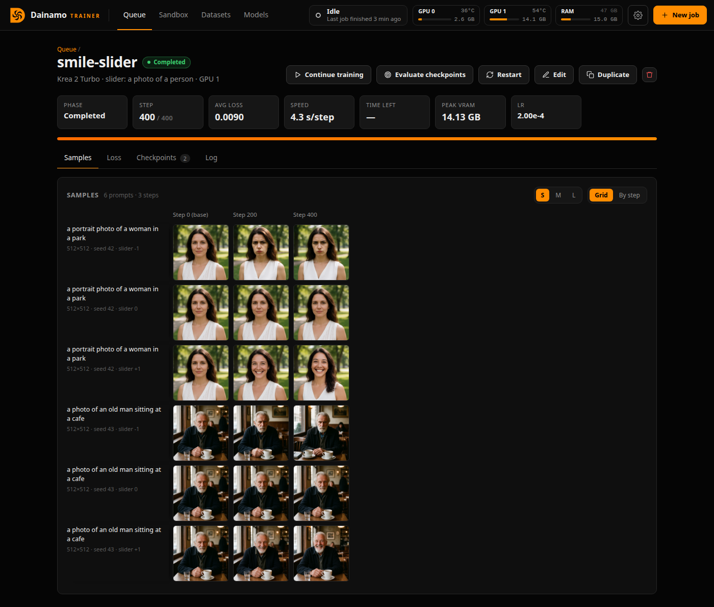

# Sliders

A slider is a LoRA whose strength moves one attribute either way: a smile slider
at +1 makes people smile, at -1 frown, and at 0.5 smile a little. Choose
**Slider** under Training method in New job (Krea 2, MOSS-Image and Qwen-Image 2.1; not
the video models yet) and give it three prompts:

- **Target**: what the slider changes, e.g. "a photo of a person". It works best
  on prompts like this one.
- **Positive** and **negative**: the target at either end, e.g. "a photo of a
  person, smiling broadly" and "a photo of a person, frowning".

The LoRA learns to push the base model's prediction for the target toward the
positive prompt at +1 and the negative at -1, scaled by **guidance strength**
(the Concept Sliders objective, Gandikota et al., 2023). A step costs about twice
a normal one.

- Captions aren't used, and a dataset is optional: its images only need to show
  the target. Without one, the base model first renders **images to render**
  (16 by default) of the target prompt and trains on those (kept in the job's
  `slider_images/`).
- Each sample prompt renders at every **sample strength** (-1 and 1 by
  default).
- Switching to Slider sets 500 steps and rank 16.
- The checkpoint picker is off: a slider isn't trained to reproduce its images.
  Concept bleed works as for a LoRA.
- The file's metadata records the prompts and settings (`dainamo.slider.*`).

## Preservation

A slider also changes things other than its attribute, more so the longer it
trains. **Preservation** limits that:

- **Keep the layout** (the default), for sliders that change a detail such as
  expression, lighting or style. Above the chosen noise level (0.9 by default;
  1 is pure noise), where the layout, clothes and background are decided, the
  slider is trained to change nothing. Those steps are also faster.
- **Keep listed attributes**, for sliders that change shape, such as age or
  weight. List things the slider shouldn't change ("outdoors", "wearing a dark
  jacket"); each step adds one, or none, to all three prompts, so the slider
  doesn't learn what tends to come with its attribute.

In testing, a smile slider on Krea 2 Turbo without preservation changed
clothes, props and backgrounds by step 200, even with the clothes among the
listed attributes. Keeping the layout held the scene, with only small things,
such as hair, moving by step 400. Using both was slightly worse than layout
alone, so New job offers one or the other.

If a slider changes too much, use an earlier checkpoint, a lower strength or a
lower guidance strength.

These samples are from a smile slider trained with **Keep the layout**: the
expression moves either way while the clothes, props and backgrounds stay.
